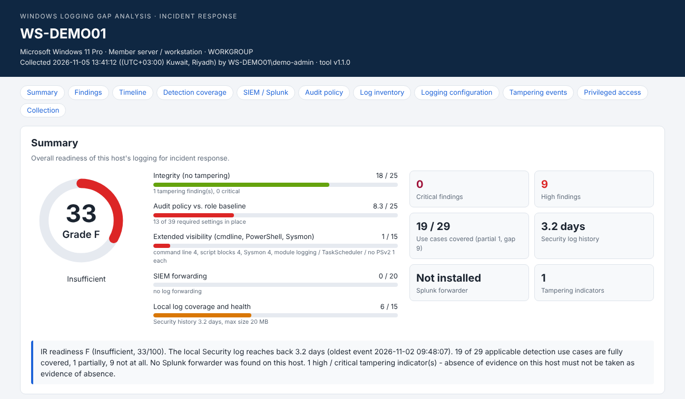

# Incident Response

Practical, lightweight tools that make incident response easier, built by practitioners for practitioners.

## Why this repository exists

Most incident response teams do not struggle with the investigation itself. They struggle with the hours before it:
the questions nobody could answer until the incident had already started.

- How far back do the logs on this server actually go, and was anything overwritten last night?
- Was auditing even switched on for the activity we now need to reconstruct?
- Did someone clear the logs or stop the audit service?
- Are the events we rely on really reaching the SIEM, or are they filtered at the forwarder?
- Who has admin rights on this host, and who logged on recently?

When these answers are missing, a responder spends the first, most valuable hours of an incident collecting basic facts,
often on a host that may already be compromised. Evidence is lost, the timeline has gaps, and decisions are made on
assumptions.

This repository collects small, focused tools that close those gaps. The goal is simple: **help IR teams be prepared
before an incident and get reliable answers fast during one.**

## Design principles

Every tool in this repository follows the same rules, because they are meant to run on systems you cannot fully trust:

- **Read-only.** Tools collect and report. They never change configuration, logs or the system state.
- **No dependencies.** Only what ships with the operating system - no installers, agents, modules or internet access.
- **Works on old systems too.** Real environments still run legacy servers. Tools support older platforms where possible
  and report what an OS cannot do instead of failing.
- **Evidence-aware.** Results can be written to external media or a share, and every output file is hashed (SHA-256).
- **Actionable output.** Each finding comes with the evidence behind it and a concrete fix, mapped to MITRE ATT&CK.
- **Honest about limits.** A clean result is not proof that a host is clean - each tool states what it cannot see.

## Tools

| Tool | Platform | Purpose |
|---|---|---|
| [Log Gap Analysis](Tools/log-gap-analysis/) | Windows, Linux | Logging readiness and gap analysis on a (potentially compromised) host: log retention and time frame, MITRE ATT&CK detection coverage, logging tampering, SIEM (Splunk) forwarding, privileged access and logons. Produces an offline HTML report with a 0-100 readiness score. |

More tools will be added over time: triage collection, persistence review, timeline helpers and readiness checklists.

## Who this is for

- **IR and DFIR teams** who need fast, trustworthy answers on a suspect host.
- **SOC teams** who want to verify that the logging their detections depend on actually exists.
- **Security architects and auditors** who assess forensic readiness before an incident, not after it.

## Contributors

This page is open to contributions from people in the security community who share the same goal: making the day-to-day
life of incident responders easier. Every tool here started as a real problem someone faced during an investigation.

A sincere thank you to the contributors who give their time and experience to build and improve these tools:

| Contributor | Contribution |
|---|---|
| [HXM14](https://github.com/HXM14) | Co-author and contributor - Log Gap Analysis |
| [Ke0xes](https://github.com/Ke0xes) (Kunal Hatode) | Real-world scenarios - [Log Gap Analysis scenarios](Tools/log-gap-analysis/SCENARIOS.md) |

Your support turns field experience into tools the whole community can use. Thank you.

## Contributing

Contributions are welcome - new tools, improvements, bug reports and test results from real environments.

- Keep tools read-only and dependency-free, in line with the design principles above.
- Include a README with purpose, usage, output and known limitations.
- Remove all confidential data (host names, user names, IP addresses, file paths) from samples and screenshots.
- Open an issue to discuss larger changes before starting.

Contributors are credited on this page and in the tools they help build.

## Disclaimer

These tools are provided as-is for defensive security and incident response. Test them in a lab before production use,
run them only on systems you are authorised to assess, and follow your organisation's evidence handling procedures.

## Maintainer

[secamin](https://github.com/secamin) - SIEM Detection Content. See also
[secamin/detection-engineering](https://github.com/secamin/detection-engineering) for SIEM detection content
(Sigma, multi-SIEM).
Co-authored-by: HXM14 <36288517+HXM14@users.noreply.github.com>
