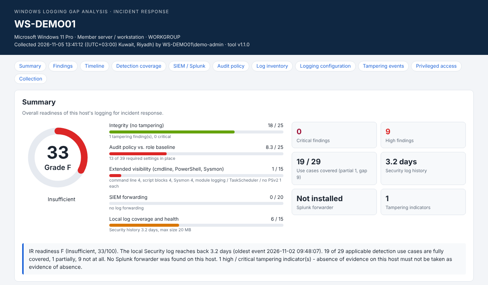
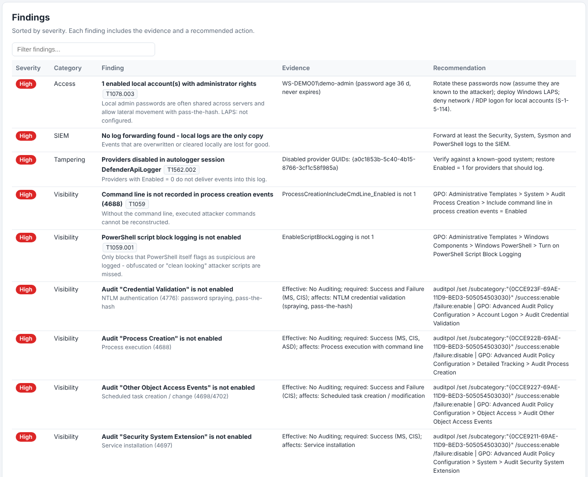
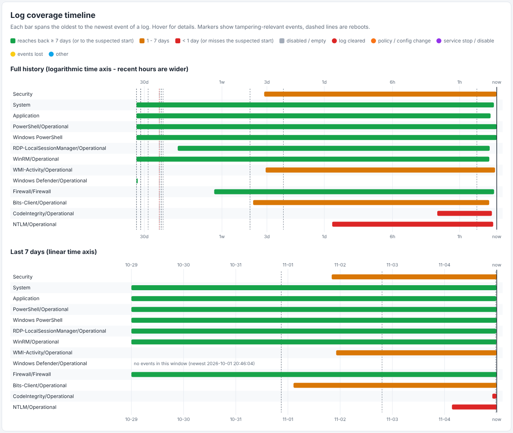
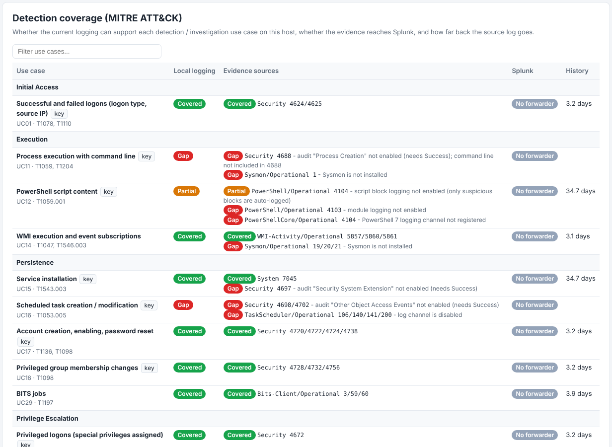
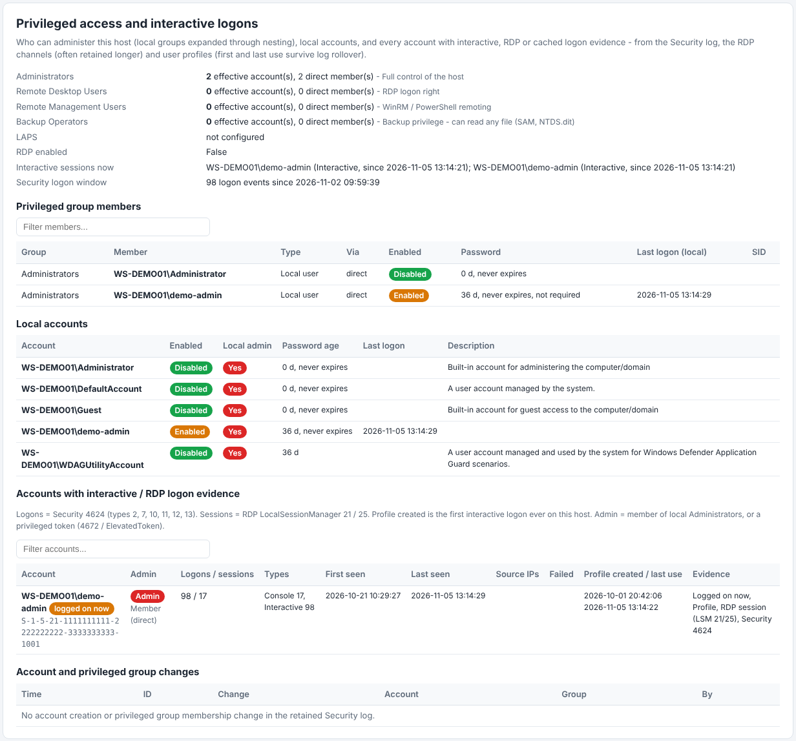
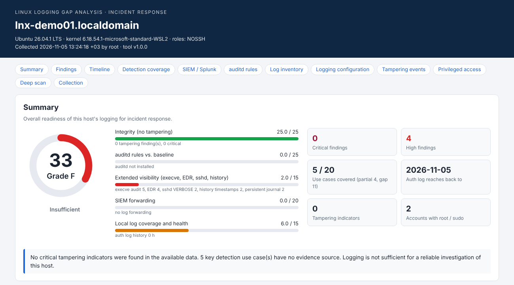
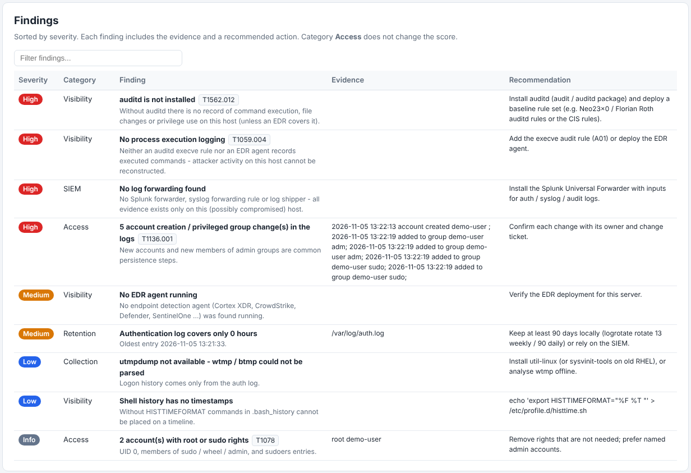
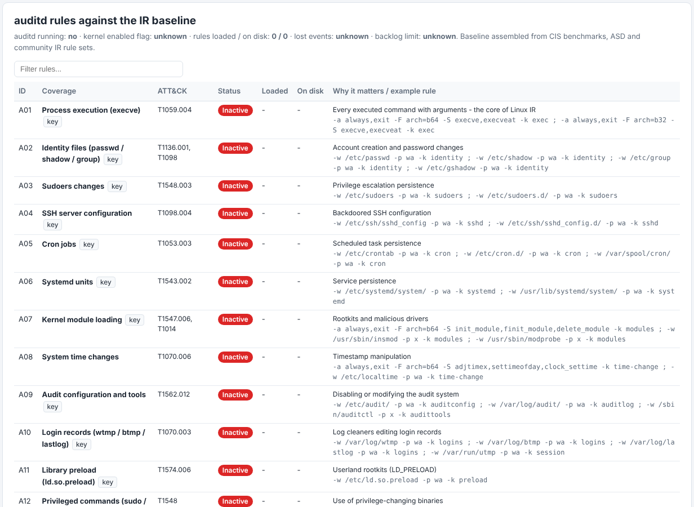

# Log Gap Analysis

Read-only logging gap analysis for incident response. Run it locally on a (potentially compromised) host to find out:

1. **Time frame** - how far back each log goes and how fast it is overwritten or rotated
2. **Visibility** - which MITRE ATT&CK detection use cases the current audit / logging configuration supports
3. **Tampering** - whether logging was weakened, cleared or switched off
4. **SIEM** - which logs and event IDs actually reach Splunk (Universal Forwarder `inputs.conf`)
5. **Access** - who holds admin / root rights and which accounts logged on, when and from where

Each run produces a self-contained `report.html` (score 0-100, grade A-F, findings, timeline, coverage matrix), `results.json`, CSV tables and a SHA-256 manifest.

| Folder | Script | Requirements |
|---|---|---|
| [windows/](windows/) | `Invoke-LogGapAnalysis.ps1` + `anti-logging-patterns.txt` | Windows Server 2008+ / Windows 10+, PowerShell 2.0+, run as Administrator |
| [linux/](linux/) | `linux-log-gap-analysis.sh` + `anti-logging-patterns-linux.txt` | RHEL / CentOS / Rocky / Alma 6-9, Ubuntu, Debian, SLES, Amazon Linux; bash 4+, run as root |

## Quick start

```powershell
# Windows - elevated PowerShell
powershell.exe -NoProfile -ExecutionPolicy Bypass -File .\Invoke-LogGapAnalysis.ps1 -OutputPath E:\IR -SuspectedStart 2026-10-15 -DeepScan
```

```bash
# Linux - as root
bash linux-log-gap-analysis.sh -o /mnt/usb/IR -s 2026-10-15 -d
```

See the README in each folder for step-by-step instructions, troubleshooting and what is checked.

Both tools are read-only and need nothing installed. A clean result is not proof that a host is clean: a rootkit can hide data from the script.

## Compliance mapping (optional)

With `-ComplianceMap` (Windows) or `-c` (Linux) every finding also carries the SOC 2 and ISO 27001 controls it is evidence for: an extra `Compliance` field in `findings.csv` and `results.json`, and a `Controls` column in `report.html`. The mapping is a CSV next to the two folders, so extending it is a data change rather than a code change, and without the flag the output is byte for byte what it was. See [compliance/README.md](compliance/README.md) for the schema and [compliance/test_control_map.py](compliance/test_control_map.py) for the check that keeps the map in step with the findings.

It is not an audit opinion. A finding marked CC7.2 means the gap sits in the evidence an auditor would ask for when testing monitoring on this host, not that an organisation failed the control.

## Why it matters

The tool solves a problem every incident response team knows: **the first hours of an incident are spent collecting
basic facts instead of investigating.** How far back do the logs go? Was auditing on? Were logs cleared? Did the SIEM
get the events? Who is an admin? Without answers, evidence is lost, the timeline has gaps, and decisions rest on
assumptions - which means longer investigations, higher response cost and weaker answers for management, auditors and
regulators.

The scenarios below are illustrative (names and values are invented), but every finding shown is one the tool
actually produces.

---

### Scenario 1: "The finance server at 2 a.m." (during an incident)

**The setup.** A mid-sized company runs a Windows file server, `FIN-SRV01`, that holds payroll data. On Monday at 02:00
the SOC gets an alert: a large amount of data left the server over the weekend. The incident responder, Priya, is
called in.

#### Without the tool

Priya connects to the server and starts asking questions by hand:

| Time | Question | What she finds |
|---|---|---|
| 09:00 | How far back do the Security logs go? | They start on Saturday 17:55. The log is small and everything older is gone. |
| 10:30 | Was auditing on for file access? | File-access auditing was never switched on. She cannot prove which files were taken. |
| 11:15 | Did someone clear the logs? | She finds a log-cleared event on Saturday at 17:55 - and almost misses it. |
| 12:00 | Did Splunk get the events before they were wiped? | The Splunk team checks the forwarder: only the Application log is sent, not the Security log. |
| 13:30 | Who is an admin on this box? | An unknown service account in the admin group, found only after expanding nested groups by hand. |

**Result:** half a day spent collecting basic facts - and only then does she learn the evidence she needed was never there.

#### With the tool

Priya plugs in a USB drive, opens PowerShell as Administrator and runs one command with the suspected start date:

```powershell
powershell.exe -NoProfile -ExecutionPolicy Bypass -File E:\IR\Invoke-LogGapAnalysis.ps1 -OutputPath E:\IR -SuspectedStart 2026-11-01 -DeepScan
```

A few minutes later she opens `report.html` from the USB drive:

| Area | What the report tells her |
|---|---|
| **Score** | 38 / 100, grade F - this host is poorly prepared for investigation (a critical tampering finding also caps the score at 59) |
| **Time frame** | The Security log covers only the last ~39 hours and does **not** reach back to the suspected start (1 Nov) |
| **Tampering** | Security log **cleared** Sat 17:55 (event 1102) **by `FIN-SRV01\svc_backup`** |
| **Visibility** | File-access auditing is off - "data from network shared drive / local system" cannot be detected (MITRE T1039 / T1005) |
| **SIEM** | The Splunk forwarder sends the Application log only; the Security log is **not collected** - with the rule and file that cause it |
| **Access** | `svc_backup` is a local administrator through a nested group, and opened an **RDP session Sat 17:40 from 10.x.x.x** - recovered from the RDP session log, which survived the Security log clear |

Every finding comes with the fix - for example the GPO path to increase the Security log size, or the exact
`auditpol /set ...` command. Every output file is listed with its SHA-256 hash, so Priya can show later that the
collected results were not changed after collection.

**Result:** in about 10 minutes Priya knows

- that the logs were wiped, when, and by which account,
- what evidence is gone for good and what she can still use,
- that she should focus on `svc_backup` and the address it connected from,
- that Splunk will not help here, so she needs other sources such as firewall, proxy and EDR telemetry.

She spends the rest of the morning investigating instead of gathering facts.

---

### Scenario 2: before anything happens (readiness check)

A SOC lead runs the same tool on 20 key servers as a health check, with no incident going on, and combines the CSV
files in Excel:

- **6 servers score below 50** - their logs are too small and hold only 1-2 days of events.
- **9 servers do not forward their Security log to Splunk** - the SOC's detections for those servers can never fire.
- **3 Linux servers have no auditd rules** for privileged commands (sudo / su) or command execution.

Each report gives the exact fix, so the team corrects the gaps. When a real incident comes, the evidence is there.

---

### The business problem it solves

| Without | With Log Gap Analysis |
|---|---|
| Hours of manual fact-finding on a possibly compromised host | One read-only command, a report in minutes |
| Gaps discovered during the incident, when it is too late | Gaps found and fixed in advance (readiness checks) |
| "We have Splunk" assumed, never verified | Per-log proof of what reaches the SIEM - and what is filtered |
| Log clearing and audit tampering easily missed | Tampering called out with time and account |
| Findings that need an expert to interpret | Each finding mapped to MITRE ATT&CK with a concrete fix |

### What the tool does not do

- It does not prove whether data was exfiltrated - it tells you which evidence exists to answer that question.
- It cannot see SACLs, so object-access findings mean "auditing is configured", not "this folder is audited".
- A rootkit can hide data from it. A clean result is not proof that a host is clean.

*Scenarios contributed by Kunal Hatode ([Ke0xes](https://github.com/Ke0xes)).*

> A standalone version of these scenarios, easy to share, is in **[SCENARIOS.md](SCENARIOS.md)**.

## Sample report

Screenshots from real runs on a Windows 11 workstation and an Ubuntu (WSL) host. Host names, account names, SIDs and IP
addresses are replaced with demo values. Both reports are single offline HTML files with filterable tables.

### Windows

**Summary** - readiness score and grade, score per area, key numbers and a verdict:



**Findings** - sorted by severity, each with ATT&CK technique, evidence and the exact fix (GPO path or auditpol command):



**Log coverage timeline** - how far back every log reaches, with reboots and tampering events:



**Detection coverage (MITRE ATT&CK)** - which use cases the logging supports, the evidence sources and whether they reach Splunk:



**Privileged access and interactive logons** - local admins (nested groups expanded), local accounts and logon history:



### Linux

**Summary:**



**Findings:**



**auditd rules against the IR baseline** - status of each rule, with a ready-to-use rule for every gap:



## Authors

- **Author:** [secamin](https://github.com/secamin) - SIEM Detection Content
- **Co-author and contributor:** [HXM14](https://github.com/HXM14)
